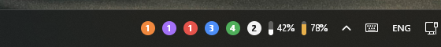

# claude-taskbar

[](LICENSE)


A tiny strip in the Windows 11 taskbar that shows your [Claude Code](https://claude.com/claude-code) sessions at a glance: one colored dot per status with the count inside it, and two bars with your usage limits. Hover for details, click to open Claude.

On the right, next to the tray (usage bars at the right edge, then statuses running right to left):



On the left, mirrored (usage bars at the left edge, then statuses running left to right):


- **Statuses:** a colored dot with the session count inside it for each status that has sessions (statuses with no sessions are hidden), so the strip grows only as needed. Starting at the edge the strip is anchored to (the right edge, or the left one with `position: "left"`) come the weekly and 5-hour usage bars, then the statuses in this order:

  | Dot | Status | Meaning |
  |---|---|---|
  | ⚪/⚫ | Idle | a session is open, doing nothing (white on a dark taskbar, black on a light one) |
  | 🟢 | Done | a background job finished |
  | 🔵 | Working | a session is busy |
  | 🔴 | Failed | a background job failed |
  | 🟣 | Plan ready | a session finished a plan and waits for your approval |
  | 🟠 | Needs input | waiting for you (a question or a permission) |

- **Tooltips:** hover a dot to see each session's name and a shortened last message. Hover a usage bar for 5-hour and weekly usage, with live countdowns to each reset.
- **Usage bars:** two thin vertical bars as tall as the status dots, filling from the bottom: the weekly limit at the anchored edge and the 5-hour limit next to the statuses. Each has its percentage next to it (turn the percentages off with `showUsagePercent`). A bar turns amber at 70% and red at 90%.
- **Notifications** (optional): a Windows toast when a session needs input, has a plan ready, finishes or fails. Click it to open Claude.
- **Click** the strip to focus your Claude window (or start Claude). **Right-click** for options.

## Light by design

- **Costs no tokens.** It only reads local files that Claude Code already writes. It never calls an API, never runs `claude`, and never talks to a session.
- **Tiny.** A ~1.6 MB native exe (.NET Native AOT, raw Win32, no UI framework). Measured on Windows 11: about 3.6 MB private memory, and under 1 MB working set when idle.
- **Idle means idle.** It sleeps until a watched folder changes or you hover it. There is no polling loop. A once-a-minute check runs only while Claude is open, to catch sessions that crashed.
- **Gets out of the way.** By default the strip disappears when Claude isn't running and comes back when a session starts. It also hides while a full-screen app is in front.

## Install

Requirements: Windows 11, the [.NET 11 SDK](https://dotnet.microsoft.com/download), and the Visual Studio **Desktop development with C++** workload (Native AOT needs the MSVC linker and Windows SDK; the Build Tools edition is enough).

```powershell
git clone https://github.com/lucaslobasso/claude-taskbar
cd claude-taskbar
.\install.ps1              # builds, installs to ~/.claude/taskbar, starts with Windows
.\install.ps1 -NoAutostart # same, without the autostart entry
```

### Usage data

The strip reads `~/.claude/taskbar/usage.json`, which a small Claude Code plugin ([`mod/`](mod), `taskbar-usage`) writes. `install.ps1` installs it at user scope (`.\install.ps1 -ModOnly` installs just the plugin). It works with any status line, or none, and costs no tokens or network: it uses the rate limits Claude Code already has, via the `session.measure` hook, which only fires when a window moves a whole point. It writes only when the taskbar folder exists.

Every open session reports the numbers from its own last request, so idle sessions carry old, lower numbers. Usage within a window only goes up, so the plugin merges readings instead of overwriting them: the newest window wins, and within a window the highest percentage wins. It writes only when that result changes.

The snapshot refreshes while a Claude Code session is working. The countdowns stay exact anyway, because they are computed from the stored reset times. After a reset, the ring shows "–" until fresh data arrives.

## Settings

Right-click the strip for the common ones, or edit `~/.claude/taskbar/taskbar.json` (changes apply on save):

| Key | Default | |
|---|---|---|
| `whenClaudeClosed` | `"hide"` | what to do when Claude is closed: `"hide"` the strip, show `"usageOnly"` (the usage bars, with countdowns that keep running), or `"show"` everything. *Closed* means no Claude terminal or agent view is open **and** no session is working or waiting: background jobs that are still running keep the dots up, and the strip drops to this mode once they finish |
| `notifications` | `true` | toast when a session changes status |
| `notifyOn` | `["needsInput","planReady","done","failed"]` | which new statuses trigger a toast (`working`, `idle` too, if you like noise) |
| `hiddenStatuses` | `[]` | statuses to leave out of the strip |
| `doneWindowHours` | `24` | finished jobs older than this drop off (`0` keeps them until archived) |
| `showUsage` | `true` | show the usage bars |
| `showUsagePercent` | `true` | show the percentage next to each usage bar |
| `position` | `"right"` | `"right"` = next to the tray, `"left"` = the taskbar's left edge (handy with centered icons). The whole strip mirrors: usage always sits at the anchored edge |
| `offsetX` | `0` | extra gap in pixels (at 100% scaling) from the chosen edge, e.g. to clear the Widgets button on the left |
| `launchCommand` | `""` | what a click starts when no Claude window is found. Empty = [claude-launcher](https://github.com/lucaslobasso/claude-launcher) if installed, else `wt.exe claude agents` |
| `focusAumid` | `"ClaudeLauncher.WindowsTerminal"` | AppUserModelID of the window a click brings to front |

## How it works

- Sessions come from `~/.claude/sessions/<pid>.json` (live processes and their `busy`/`waiting`/`idle` status) merged with `~/.claude/jobs/<id>/state.json` (background job state and its one-line summary; a blocked job whose detail is "approve plan" is shown as Plan ready). Whether Claude is "open" is decided by looking for Claude terminal processes (the daemon and its background sessions do not count) and is re-checked only when a watched folder changes, the foreground window changes while closed, or a terminal exits. A session counts as live only if its process exists **and** started at the recorded time, so a reused PID can't fool it.
- The strip is a per-pixel-alpha layered window owned by the taskbar, so it stays drawn above it. It follows the tray's size, DPI and light/dark changes, and re-docks if Explorer restarts.
- Notifications use the shell's notification API. A tray icon exists only while a toast is up.

## Troubleshooting

- **Nothing shows up.** That's expected while Claude isn't running (see `whenClaudeClosed`). Otherwise check `~/.claude/taskbar/taskbar.log`. Run with `CLAUDE_TASKBAR_DEBUG=1` set for more detail.
- **The usage bars are missing.** No usage snapshot has been written yet. See [Usage data](#usage-data).
- **No toasts.** Windows Do Not Disturb sends them straight to the notification center.
- **With `position: "left"`, it overlaps the Widgets button.** Raise `offsetX`, or turn Widgets off (Settings → Personalization → Taskbar).

## Uninstall

```powershell
.\uninstall.ps1          # stop, remove autostart and the exe
.\uninstall.ps1 -Purge   # also delete settings, usage snapshot and log
```

## License

[MIT](LICENSE)
