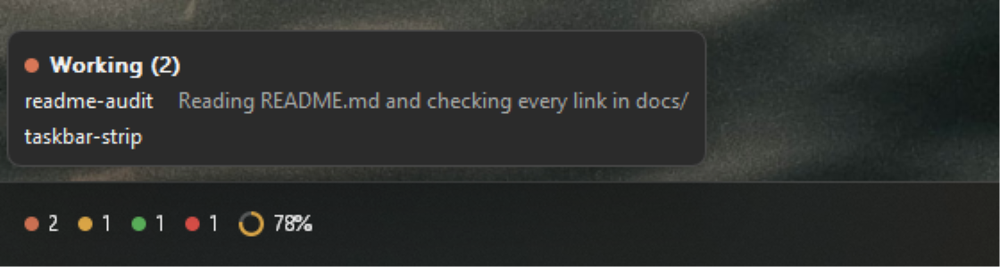

# claude-taskbar

[](LICENSE)


A tiny strip in the Windows 11 taskbar that shows your [Claude Code](https://claude.com/claude-code) sessions at a glance: one colored dot and a count per status, and a ring with your usage limits. Hover for details, click to open Claude.



- **Statuses:** a dot and a count for each status that has sessions (statuses with no sessions are hidden), so the strip grows only as needed.

  | Dot | Status | Meaning |
  |---|---|---|
  | 🟠 | Working | a session is busy |
  | 🟡 | Needs input | waiting for you (a question or a permission) |
  | 🟢 | Done | a background job finished |
  | 🔴 | Failed | a background job failed |
  | ⚪ | Idle | a session is open, doing nothing |

- **Tooltips:** hover a dot to see each session's name and a shortened last message. Hover the ring for 5-hour and weekly usage, with live countdowns to each reset.
- **Usage ring:** shows the limit that is closest to full. It turns amber at 70% and red at 90%.
- **Notifications** (optional): a Windows toast when a session needs input, finishes or fails. Click it to open Claude.
- **Click** the strip to focus your Claude window (or start Claude). **Right-click** for options.

## Light by design

- **Costs no tokens.** It only reads local files that Claude Code already writes. It never calls an API, never runs `claude`, and never talks to a session.
- **Tiny.** A ~1.6 MB native exe (.NET Native AOT, raw Win32, no UI framework). Measured on Windows 11: about 3.6 MB private memory, and under 1 MB working set when idle.
- **Idle means idle.** It sleeps until a watched folder changes or you hover it. There is no polling loop. A once-a-minute check runs only while Claude is open, to catch sessions that crashed.
- **Gets out of the way.** By default the strip disappears when Claude isn't running and comes back when a session starts. It also hides while a full-screen app is in front.

## Install

Requirements: Windows 11, the [.NET 11 SDK](https://dotnet.microsoft.com/download), and the Visual Studio **Desktop development with C++** workload (Native AOT needs the MSVC linker and Windows SDK; the Build Tools edition is enough).

```powershell
git clone https://github.com/lucaslobasso/claude-taskbar
cd claude-taskbar
.\install.ps1              # builds, installs to ~/.claude/taskbar, starts with Windows
.\install.ps1 -NoAutostart # same, without the autostart entry
```

### Usage data

Claude Code gives the rate-limit numbers only to the **status line**, so the strip reads a small snapshot that your status line writes. Add [`statusline/usage-snapshot.mjs`](statusline/usage-snapshot.mjs) to your status line script and call `snapshotUsage(input)` with the parsed status JSON. It writes `~/.claude/taskbar/usage.json` only when that folder exists, at most every 30 seconds.

The snapshot refreshes while an interactive Claude Code session shows its status line. The countdowns stay exact anyway, because they are computed from the stored reset times. After a reset, the ring shows "–" until fresh data arrives.

## Settings

Right-click the strip for the common ones, or edit `~/.claude/taskbar/taskbar.json` (changes apply on save):

| Key | Default | |
|---|---|---|
| `whenClaudeClosed` | `"hide"` | `"hide"` the strip, show `"usageOnly"` (the ring, with countdowns that keep running), or `"show"` everything |
| `notifications` | `true` | toast when a session changes status |
| `notifyOn` | `["needsInput","done","failed"]` | which new statuses trigger a toast (`working`, `idle` too, if you like noise) |
| `hiddenStatuses` | `[]` | statuses to leave out of the strip |
| `doneWindowHours` | `24` | finished jobs older than this drop off (`0` keeps them until archived) |
| `showUsage` | `true` | show the usage ring |
| `position` | `"right"` | `"right"` = next to the tray, `"left"` = the taskbar's left edge (handy with centered icons) |
| `offsetX` | `0` | extra gap in pixels (at 100% scaling) from the chosen edge, e.g. to clear the Widgets button on the left |
| `launchCommand` | `""` | what a click starts when no Claude window is found. Empty = [claude-launcher](https://github.com/lucaslobasso/claude-launcher) if installed, else `wt.exe claude agents` |
| `focusAumid` | `"ClaudeLauncher.WindowsTerminal"` | AppUserModelID of the window a click brings to front |

## How it works

- Sessions come from `~/.claude/sessions/<pid>.json` (live processes and their `busy`/`waiting`/`idle` status) merged with `~/.claude/jobs/<id>/state.json` (background job state and its one-line summary). A session counts as live only if its process exists **and** started at the recorded time, so a reused PID can't fool it.
- The strip is a per-pixel-alpha layered window owned by the taskbar, so it stays drawn above it. It follows the tray's size, DPI and light/dark changes, and re-docks if Explorer restarts.
- Notifications use the shell's notification API. A tray icon exists only while a toast is up.

## Troubleshooting

- **Nothing shows up.** That's expected while Claude isn't running (see `whenClaudeClosed`). Otherwise check `~/.claude/taskbar/taskbar.log`. Run with `CLAUDE_TASKBAR_DEBUG=1` set for more detail.
- **The ring is missing.** No usage snapshot has been written yet. See [Usage data](#usage-data).
- **No toasts.** Windows Do Not Disturb sends them straight to the notification center.
- **With `position: "left"`, it overlaps the Widgets button.** Raise `offsetX`, or turn Widgets off (Settings → Personalization → Taskbar).

## Uninstall

```powershell
.\uninstall.ps1          # stop, remove autostart and the exe
.\uninstall.ps1 -Purge   # also delete settings, usage snapshot and log
```

## License

[MIT](LICENSE)
