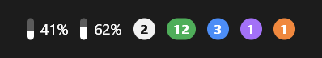
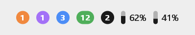
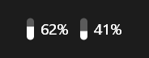
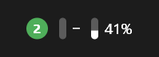

# Claude Taskbar

[](https://github.com/lucaslobasso/claude-taskbar/actions/workflows/ci.yml)
[](https://github.com/lucaslobasso/claude-taskbar/releases)
[](LICENSE)
[](#requirements)
[](#light-by-design)

<p align="center">
  
</p>

A tiny strip in the Windows 11 taskbar that shows your [Claude Code](https://code.claude.com/docs) sessions at a glance: one colored dot per status with the count inside it, and two bars with your usage limits. Hover for details, click to open Claude. It costs no tokens and almost no memory.

> Unofficial community project, not affiliated with Anthropic.

**[Requirements](#requirements) · [Install](#install) · [Settings](#settings) · [How it looks](#how-it-looks) · [Update](#update) · [How it works](#how-it-works) · [Troubleshooting](#troubleshooting) · [Uninstall](#uninstall) · [Install the whole set](#install-the-whole-set)**

## What you get

- **Statuses:** a colored dot with the session count for each status that has sessions, so the strip grows only as needed. From the edge the strip is anchored to come the weekly and 5-hour usage bars, then:

| Dot | Status | Meaning |
  |---|---|---|
  | ⚪/⚫ | Idle | a session is open, doing nothing (white on a dark taskbar, black on a light one) |
  | 🟢 | Done | a background job finished |
  | 🔵 | Working | a session is busy |
  | 🔴 | Failed | a background job failed |
  | 🟣 | Plan ready | a session finished a plan and waits for your approval |
  | 🟠 | Needs input | waiting for you (a question or a permission) |

- **Tooltips:** hover a dot for each session's name and a shortened last message. Hover a usage bar for 5-hour and weekly usage, with live countdowns to each reset.
- **Usage bars:** thin vertical bars as tall as the dots, filling from the bottom, with the percentage beside them. Amber from 70%, red from 90%.
- **Notifications** (optional): a Windows toast when a session needs input, has a plan ready, finishes or fails. Click it to open Claude.
- **Click** the strip to focus your Claude window (or start Claude). **Right-click** for options and to check for updates.

### Light by design

- **Costs no tokens.** It only reads local files that Claude Code already writes. It never calls an API, never runs `claude`, and never talks to a session.
- **No network.** The one exception is yours to trigger: **Check for updates** in the right-click menu asks GitHub for the latest release, and only when you click it.
- **Tiny.** A ~1.6 MB native exe (.NET Native AOT, raw Win32, no UI framework): about 3.6 MB private memory, under 1 MB working set when idle.
- **Idle means idle.** It sleeps until a watched folder changes or you hover it. No polling loop; a once-a-minute check runs only while Claude is open, to catch sessions that crashed.
- **Gets out of the way.** By default the strip disappears when Claude isn't running, and it hides while a full-screen app is in front.

## Requirements

- Windows 11 (Windows 10 works, but the strip is designed for the Windows 11 taskbar).
- [Claude Code](https://code.claude.com/docs) 2.1.3xx or newer, for the usage plugin. Statuses work with any version.
- Nothing else for the one-line install: the release is a self-contained native exe.

## Install

**One line** (PowerShell, no SDK or git needed):

```powershell
irm https://raw.githubusercontent.com/lucaslobasso/claude-taskbar/main/bootstrap.ps1 | iex
```

It downloads `ClaudeTaskbar.exe` from the latest release, checks its SHA-256, installs it to `~/.claude/taskbar`, starts it with Windows, and installs the `taskbar-usage` plugin into Claude Code. Read [`bootstrap.ps1`](bootstrap.ps1) first if you like; it's short. Without autostart:

```powershell
& ([scriptblock]::Create((irm https://raw.githubusercontent.com/lucaslobasso/claude-taskbar/main/bootstrap.ps1))) -NoAutostart
```

**From source** (contributors): needs the [.NET 11 SDK](https://dotnet.microsoft.com/download) and the Visual Studio **Desktop development with C++** workload (Native AOT uses the MSVC linker; Build Tools are enough).

```powershell
git clone https://github.com/lucaslobasso/claude-taskbar
cd claude-taskbar
.\install.ps1              # builds, installs, starts with Windows; -NoAutostart, -ModOnly, -LocalMod
```

### Usage data

The strip reads `~/.claude/taskbar/usage.json`, which a small Claude Code plugin ([`mod/`](mod), `taskbar-usage`) writes. The installers add it at user scope from this repo's marketplace (`taskbar-usage@claude-taskbar`). It works with any status line, or none, and costs no tokens or network: it uses the rate limits Claude Code already has, via the `session.measure` hook, which only fires when a window moves a whole point. It writes only when the taskbar folder exists.

Every open session reports the numbers from its own last request, so idle sessions carry old, lower numbers. Usage within a window only goes up, so the plugin merges readings instead of overwriting them: the newest window wins, and within a window the highest percentage wins. It writes only when that result changes.

The snapshot refreshes while a Claude Code session is working. The countdowns stay exact anyway, because they are computed from the stored reset times. After a reset, the 5-hour bar is hidden until the next session brings fresh data; the weekly bar shows "–" meanwhile.

## Settings

Right-click the strip for the common ones, or edit `~/.claude/taskbar/taskbar.json` (changes apply on save):

| Key | Default | |
|---|---|---|
| `whenClaudeClosed` | `"hide"` | what to do when Claude is closed: `"hide"` the strip, show `"usageOnly"` (the usage bars, with countdowns that keep running), or `"show"` everything. *Closed* means no Claude terminal or agent view is open **and** no session is working or waiting: background jobs that are still running keep the dots up, and the strip drops to this mode once they finish |
| `notifications` | `true` | toast when a session changes status |
| `notifyOn` | `["needsInput","planReady","done","failed"]` | which new statuses trigger a toast (`working`, `idle` too, if you like noise) |
| `hiddenStatuses` | `[]` | statuses to leave out of the strip |
| `doneWindowHours` | `24` | finished jobs older than this drop off (`0` keeps them until archived) |
| `showUsage` | `true` | show the usage bars |
| `showUsagePercent` | `true` | show the percentage next to each usage bar |
| `position` | `"right"` | `"right"` = next to the tray, `"left"` = the taskbar's left edge (handy with centered icons). The whole strip mirrors: usage always sits at the anchored edge |
| `offsetX` | `0` | extra gap in pixels (at 100% scaling) from the chosen edge, e.g. to clear the Widgets button on the left |
| `launchCommand` | `""` | what a click starts when no Claude window is found. Empty = [claude-launcher](https://github.com/lucaslobasso/claude-launcher) if installed, else `wt.exe claude agents` |
| `focusAumid` | `"ClaudeLauncher.WindowsTerminal"` | AppUserModelID of the window a click brings to front |

## How it looks

<sub>Pictures drawn by the app's own rendering code (`ClaudeTaskbar.exe --render`, see [Contributing](#contributing)) at 150% scaling, on the Windows 11 taskbar colors.</sub>

| Setting | Strip |
| --- | --- |
| `position: "right"` (default): usage next to the tray |  |
| `position: "left"`: mirrored, usage at the left edge |  |
| Light taskbar (follows the Windows theme) |  |
| Every status: needs input, plan ready, failed, working, done (10+ becomes a pill), idle |  |
| Usage at 93% (red) and 74% (amber) |  |
| `showUsagePercent: false` |  |
| `whenClaudeClosed: "usageOnly"`, with Claude closed |  |
| The 5-hour window has reset and no new session has started: its bar is hidden until the next reading |  |

## Update

Right-click the strip → **Check for updates**. If there is a newer release it asks, downloads it, checks it against the release's SHA-256, replaces the exe and restarts; your settings stay. It then brings the usage plugin up to date with `claude plugin update` (this is the only time the app runs `claude`; it costs no tokens). It never checks on its own.

Versions before 1.3 have no such entry: run the one-line install again (it also replaces the exe and keeps your settings). From a clone: `git pull`, then `.\install.ps1`. See [CHANGELOG.md](CHANGELOG.md).

## How it works

- Sessions come from `~/.claude/sessions/<pid>.json` (live processes and their `busy`/`waiting`/`idle` status) merged with `~/.claude/jobs/<id>/state.json` (background job state and its one-line summary; a blocked job whose detail is "approve plan" is shown as Plan ready). Whether Claude is "open" is decided by looking for Claude terminal processes (the daemon and its background sessions do not count) and is re-checked only when a watched folder changes, the foreground window changes while closed, or a terminal exits. A session counts as live only if its process exists **and** started at the recorded time, so a reused PID can't fool it.
- The strip is a per-pixel-alpha layered window owned by the taskbar, so it stays drawn above it. It follows the tray's size, DPI and light/dark changes, and re-docks if Explorer restarts.
- Notifications use the shell's notification API. A tray icon exists only while a toast is up.

## Troubleshooting

- **Nothing shows up.** That's expected while Claude isn't running (see `whenClaudeClosed`). Otherwise check `~/.claude/taskbar/taskbar.log`; set `CLAUDE_TASKBAR_DEBUG=1` for more detail.
- **The usage bars are missing.** No usage snapshot yet: check that `claude plugin list` shows `taskbar-usage@claude-taskbar`, then let a session do some work. See [Usage data](#usage-data).
- **Windows SmartScreen warns about the exe.** It isn't code-signed. The one-line install checks the release's SHA-256 and unblocks the file; you can also build it yourself from source.
- **No toasts.** Windows Do Not Disturb sends them straight to the notification center.
- **Next to Taskbar Glance** (weather/calendar strip): it takes the anchored edge and this strip docks just outside it automatically; no `offsetX` needed.
- **With `position: "left"`, it overlaps the Widgets button.** Raise `offsetX`, or turn Widgets off (Settings → Personalization → Taskbar).
- **A click opens a plain terminal instead of Claude.** Set `launchCommand`, or install [Claude Launcher](https://github.com/lucaslobasso/claude-launcher).

## Uninstall

```powershell
& ([scriptblock]::Create((irm https://raw.githubusercontent.com/lucaslobasso/claude-taskbar/main/bootstrap.ps1))) -Uninstall          # add -Purge to also delete settings, usage snapshot and log
```

From a clone: `.\uninstall.ps1` (or `.\uninstall.ps1 -Purge`). Both also remove the `taskbar-usage` plugin.

<!-- bundle:start (copied from claude-launcher/docs/bundle-section.md; edit it there and copy to all six READMEs) -->
## Install the whole set

This is one of six small tools that work well together. Each installs on its own, or get them all with one command:

| Tool | What it does | Runs on |
| --- | --- | --- |
| [Claude Launcher](https://github.com/lucaslobasso/claude-launcher) | One click from the taskbar or Start menu straight into Claude Code, with a Claude icon and a loading spinner | Windows |
| [Claude Taskbar](https://github.com/lucaslobasso/claude-taskbar) | Your Claude sessions and usage limits as dots and bars on the Windows taskbar | Windows |
| [boxed-messages](https://github.com/lucaslobasso/claude-boxed-messages) | Colored boxes around your prompts and Claude's replies | Any |
| [claude-statusline](https://github.com/lucaslobasso/claude-statusline) | A status line with model, context, branch, and usage only when it gets high | Any |
| [claude-sessions](https://github.com/lucaslobasso/claude-sessions) | limit-revive resumes unfinished work after the 5-hour or weekly limit resets, context-handoff continues in a fresh session before the context fills, subagentify splits planned work across Opus and Sonnet subagents | Any |
| [language-spinner](https://github.com/lucaslobasso/claude-language-spinner) | The "thinking" spinner shows words in a language you are learning | Any |

**Windows** (PowerShell 7):

```powershell
irm https://raw.githubusercontent.com/lucaslobasso/claude-launcher/main/bundle.ps1 | iex
```

To pick, pass options: `-Only statusline,limit-revive`, `-Skip launcher`, `-List` (show what is installed) or `-Uninstall`:

```powershell
& ([scriptblock]::Create((irm https://raw.githubusercontent.com/lucaslobasso/claude-launcher/main/bundle.ps1))) -Skip taskbar
```

**macOS and Linux:** the plugins work everywhere. In a shell:

```sh
for p in boxed-messages statusline language-spinner; do
  claude plugin marketplace add "lucaslobasso/claude-$p"
  claude plugin install "$p@claude-$p" --scope user
done
claude plugin marketplace add lucaslobasso/claude-sessions
for p in limit-revive context-handoff subagentify; do
  claude plugin install "$p@claude-sessions" --scope user
done
```
<!-- bundle:end -->

## Contributing

```powershell
dotnet publish src/ClaudeTaskbar.csproj -c Release -o out   # Native AOT build
node --test "mod/test/*.test.ts"                                        # usage plugin tests
python docs/render.py                                        # redraw the README pictures (pip install pillow)
```

- Test against a fake `CLAUDE_CONFIG_DIR`, never your real `~/.claude/jobs` (see [CLAUDE.md](CLAUDE.md)).
- `ClaudeTaskbar.exe --render out.bgra five=62 week=41 working=3 [left] [light] [nopct] ...` draws the strip for made-up values without opening a window; `docs/render.py` turns that into the PNGs above.
- Releases publish themselves: when `main` carries a `<Version>` (in `src/ClaudeTaskbar.csproj`) that has no release yet, CI builds the exe and publishes it with its SHA-256, which the one-line install and **Check for updates** pick up. So a pull request that bumps the version and adds its `CHANGELOG.md` section is a release once merged; any other merge publishes nothing.

## License

[MIT](LICENSE) © Lucas Lobasso
